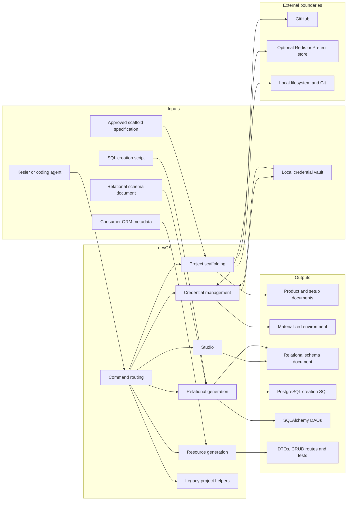
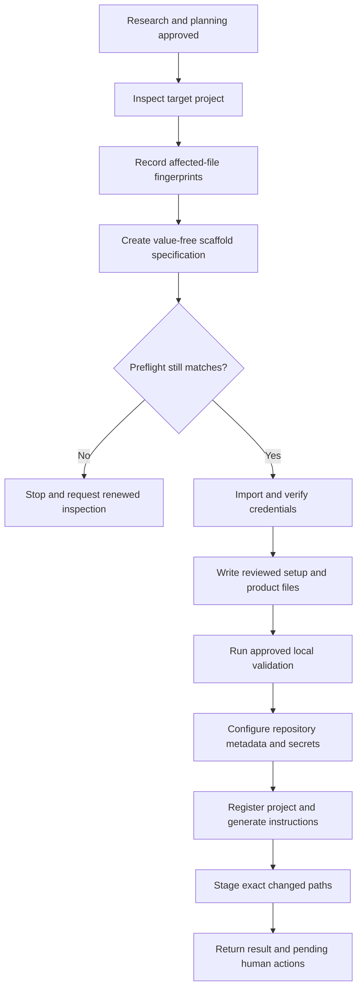
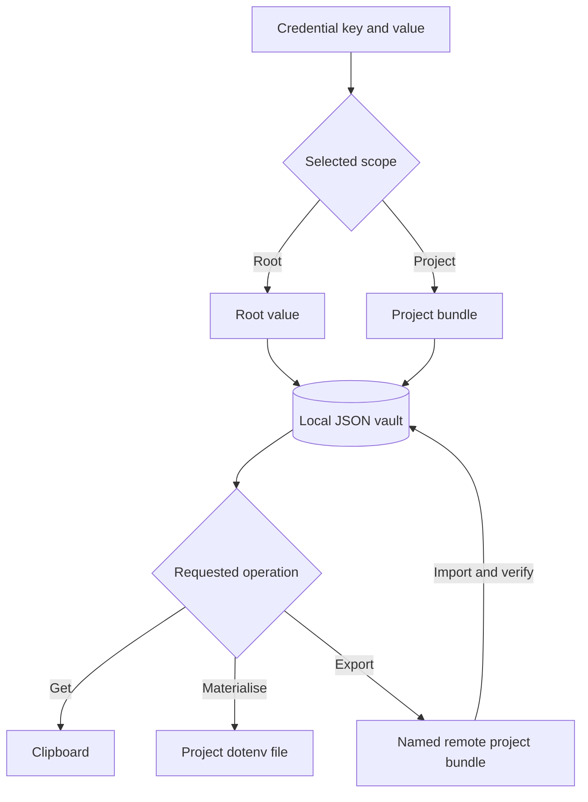
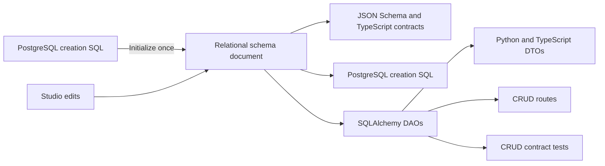
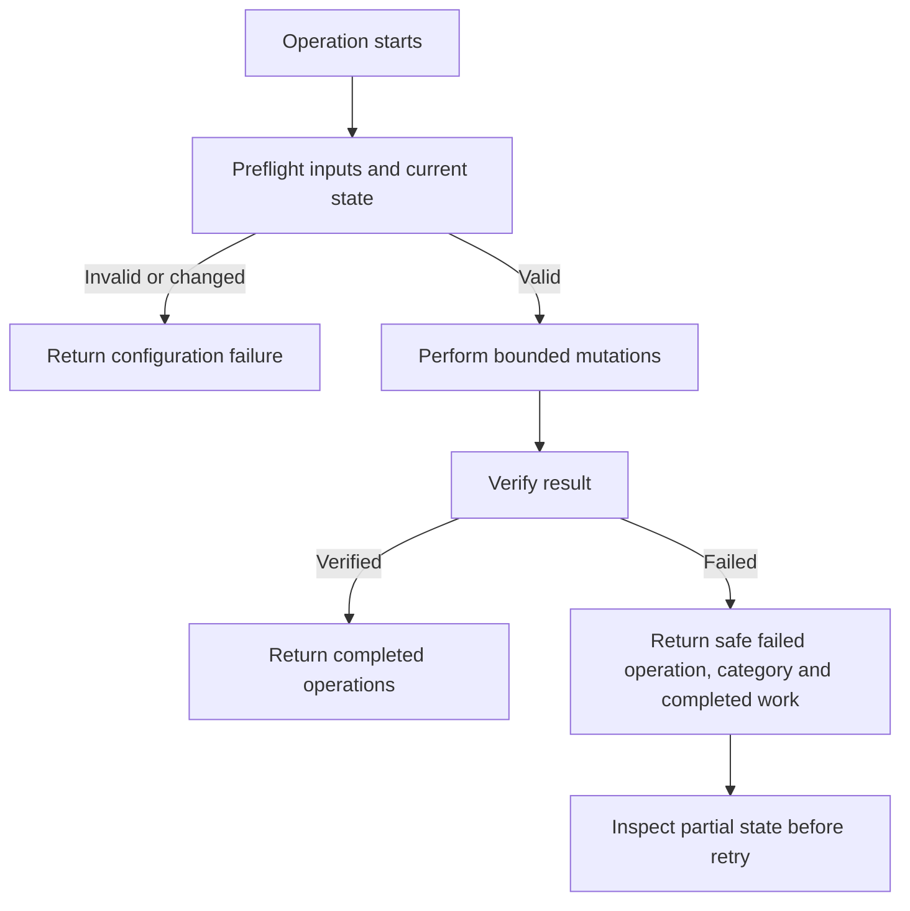

# devOS system specification



## System boundary

devOS is a local developer operating system for Protocol projects. It turns an
approved, value-free setup specification into reviewable project changes, manages
credentials through a local vault, provides a relational schema editor and produces
targeted generated artifacts. It does not decide product requirements, implement
application features, deploy or operate a migration service. Scaffolding and
generation do not commit or push. The explicit legacy commit and release helpers do.

- The operator invokes devOS explicitly. There is no schedule or background worker.
- The current working repository supplies project identity where a command needs it.
- Product decisions and approvals happen before scaffolding.
- Confidential values enter through the credential boundary and never through a
  scaffold specification or generated documentation.
- Generated artifacts have designated ownership. Project-owned files are preserved.
- Every external mutation is bounded to the selected project, repository or store.

## Executable surface contract

<!-- spec-contract -->
```json
{
  "product": "devOS",
  "execution": "operator-triggered",
  "credential_authority": "local-json-vault",
  "command_roots": [
    "add",
    "build",
    "commit",
    "config",
    "delete",
    "export",
    "get",
    "import",
    "list",
    "materialise",
    "release",
    "scaffold",
    "schema",
    "set",
    "setup",
    "sync",
    "ui",
    "version"
  ],
  "generated_owners": [
    "relational-schema",
    "creation-sql",
    "sqlalchemy-dao",
    "resource-dto",
    "resource-api",
    "resource-contract-test"
  ],
  "protected_owners": [
    "application-feature",
    "custom-test",
    "database-migration",
    "product-design"
  ]
}
```

The command roots are the stable user-facing entry points. Subcommands narrow the
operation. Generated owners identify artifacts that may be deterministically
replaced after their input is validated. Protected owners identify content devOS
must not invent or overwrite.

## Command surfaces

| Surface | Primary operations | Result |
| --- | --- | --- |
| Credentials | configure, list, set, get, delete, materialise, import, export | Scoped vault changes, clipboard retrieval, dotenv materialization or optional store transfer |
| Scaffolding | inspect, apply, credentials apply, secrets apply, schema | Read-only inspection or an approved, staged project setup |
| Relational schema | validate, import SQL, export SQL, export contracts | Validated schema document and deterministic derived contracts |
| Resource build | DAO, DTO, API, contract tests, custom test scaffolds | Designated generated files or a new project-owned test scaffold |
| Studio | launch local editor | Browser-based authoring of the relational schema document |
| Project helpers | setup, config, sync, add docs, build context, commit, release, version | Existing project-specific maintenance workflows |

The credential, scaffold, schema, resource and Studio surfaces can start without
initializing the legacy project wizard. Legacy helpers may require project
configuration and Git state.

## Project scaffolding



### Inputs

- A Protocol root and target project identity
- Approved product requirements, decision log and README content
- Stack selection for Python, React or fullstack setup
- Reviewed file additions or replacements
- Expected fingerprints for every affected existing file
- Credential conflict resolutions containing key names and source choices only
- Repository owner, name and the key name for a stored GitHub token
- Explicit local validation commands expressed as argument arrays
- Optional CI store selection and approved CI or CD files

### Rules

- Inspection is read-only and works before Git initialization.
- Every existing affected file must still match its inspected fingerprint.
- The specification rejects unknown fields and escaping or symbolic-link paths.
- Existing layout, useful content, remotes, visibility and unrelated changes survive.
- Existing CI remains unless its replacement was explicitly approved.
- React browser code never receives a server credential loader.
- Python settings load the materialized dotenv file without interpolating values.
- New repositories are private and have no initial commit.
- Only exact scaffold paths are staged. devOS never commits or pushes the scaffold.
- Validation output is captured so confidential values cannot leak into normal output.

### Outputs

| Output | Ownership |
| --- | --- |
| Product requirements and decision log | Target project |
| Design document | Kesler, except the dedicated source-table inventory |
| README and setup files | Target project |
| Typed local settings support | Target project after installation |
| Generated project instructions | Project guide synchronization |
| Repository metadata and Actions secret names | GitHub repository |
| Applied and staged path list | Scaffold result |
| Pending review, push, deployment or live verification | TickTick and human workflow |

## Credential system



### Authority and scope

- The configured local JSON vault is the credential authority.
- Root values and project bundles share one key vocabulary.
- Project objects use an internal prefix that is hidden from command users.
- A project is identified by the current repository's origin name.
- Projects never inherit root values.
- If the same key exists at root and project scope, reads and deletions require an
  explicit scope.
- Replacing an existing value requires an explicit force option.
- Credential retrieval copies the value to the clipboard and prints only a success
  acknowledgement.

### Materialization and transfer

- Materialization writes only the selected project bundle into its local dotenv file.
- Import changes the vault only. Materialization is always a separate operation.
- Redis and Prefect are optional named transfer targets, not the default authority.
- Remote transfer uses one project bundle and verifies readback.
- Project names that resolve to the same remote identity are rejected.
- The user owns vault history and recovery through an external versioned location.

### Confidentiality

- Scaffold specifications, logs, exceptions and reports contain key names only.
- Secret values are not printed during successful or failed operations.
- Unknown input fields are rejected without echoing their values.
- GitHub secrets are sealed locally before upload.
- Readback verifies secret names and metadata, never plaintext values.

## Relational authoring



The relational schema document is the single editable authority. SQL import creates
a new document. Later edits happen in Studio or by editing the document. SQL, DAOs
and resource artifacts flow outward only. There is no reverse synchronization,
database introspection or live migration application.

### Document schema

| Area | Contract |
| --- | --- |
| Version | Version 1 |
| Namespaces | Explicit PostgreSQL namespaces |
| Types | Supported scalars, document enums and arrays with retained dimensions |
| Columns | Stable identity, ordered position, nullability, type, generation and default |
| Keys | Ordered primary and unique column identities |
| Foreign keys | Ordered source and target identities with actions and deferrability |
| Checks | One-table SQL expressions with verified column references |
| Indexes | Ordinary btree indexes, optionally unique |
| Layout | Optional table positions, colours and viewport |
| ORM configuration | Optional table, column and navigation naming without physical columns |

### Relational invariants

- All identities are nonempty and unique across the document.
- Unquoted SQL names are lowercase. Quoted names preserve case and punctuation.
- PostgreSQL names fit the 63-byte identifier limit.
- Primary-key columns are non-nullable and each table has at most one primary key.
- Foreign keys target a non-deferrable primary key, unique key or unique index.
- Composite key and foreign-key order is meaningful and preserved.
- Serial and identity generation apply only to eligible scalar integer columns.
- Large identity sequence integers use decimal strings outside JavaScript's safe
  integer range.
- Defaults cannot reference columns. Checks can reference only their owning table.
- Expressions cannot contain statements, queries or aliases.
- Unknown fields and unsupported database constructs fail explicitly.
- Diagram layout and ORM configuration never change physical schema semantics.

### Supported and excluded database scope

Supported behavior includes namespaces, quoted names, enums, arrays, precise type
parameters, ordered columns, defaults, identity, composite keys, checks, ordinary
indexes, referential actions and deferrability.

The bounded release excludes views, functions, triggers, partitioning, live database
introspection and migration generation or application.

## Studio

Studio is a local browser interface bound to the loopback host. It authors the same
portable relational schema document used by command-line generation.

- The user can create and edit namespaces, enums, tables, columns, keys, foreign
  keys, checks, indexes and diagram layout.
- The interface validates structural and semantic rules before export.
- Navigation configuration is visually distinct from physical columns.
- SQL preview is derived from the current document.
- The established centered navigation, gradient title, dotted canvas, coloured
  table strips, teal table names, row controls, handles and information panels stay
  consistent with the product design.
- Studio does not connect to or mutate a live database.

## Generated artifacts

### Relational outputs

| Input | Output | Replacement rule |
| --- | --- | --- |
| Relational schema document | JSON Schema and TypeScript declarations | Replace designated contract files |
| Relational schema document | PostgreSQL creation SQL | Replace designated generated SQL |
| Relational schema document | SQLAlchemy DAOs | Replace a recognized generated DAO file |
| SQL creation script | New relational schema document | Create only, never overwrite schema authority |

### Resource outputs

Resource generation imports a selected consumer DAO module and projects its mapped
SQLAlchemy metadata into the following artifacts. The consumer must keep that import
free of application startup and live-service side effects.

| Artifact | Contract |
| --- | --- |
| Python DTOs | Validated write, patch, read and finite relationship models |
| TypeScript DTOs | Matching Zod validators and inferred types |
| CRUD routes | Standard create, list, read, patch, delete and relationship routes |
| Contract tests | Regenerable tests for standard generated behavior |
| Custom API or use-case test scaffold | New project-owned skipped test awaiting requirements and fixtures |

### Resource semantics

- Resource names derive from mapped class names without a DAO suffix.
- Primary-key order defines route identity order.
- Single and complete composite keys are supported.
- Array, JSON and binary keys require custom routes.
- Write fields may be omitted when nullable or supplied by database generation.
- Always-generated columns cannot be supplied.
- Patch accepts only supplied non-key scalar fields and distinguishes omission from
  explicit null.
- Primary keys cannot be mutated.
- Bigint and numeric wire values are strings.
- Binary values use base64. UUID and temporal values use strings.
- Arrays retain their declared dimensions.
- Read models are shallow. Relationship expansion adds one finite related layer.
- Missing resources return 404, invalid payloads return 422 and relational conflicts
  return 409.
- The consuming application supplies the database session and mounts the router.
- Authorization, transaction composition and business routes remain application-owned.

### Ownership and collision protection

- Generated files carry a devOS ownership header.
- Regeneration replaces only a recognized generated destination.
- An input file cannot also be an output destination.
- Project-owned files and custom tests cannot be overwritten.
- Installed CRUD machinery, configuration, adapters and clients belong to the target
  project and are not recopied by recurring generation.

## External effects

| Boundary | Allowed effect | Verification |
| --- | --- | --- |
| Local filesystem | Write approved setup or designated generated files | Preflight fingerprint and ownership marker |
| Local Git | Inspect repository identity and stage exact scaffold paths | Re-read staged path list |
| Clipboard | Receive one requested credential value | Success acknowledgement without value output |
| Local vault | Atomic credential document replacement | Parse and readback selected scope |
| Redis or Prefect | Transfer one selected project bundle | Storage identity and value readback |
| GitHub | Create a private empty repository, update description and upload sealed secrets | Repository metadata and secret-name readback |
| Local browser | Run Studio on a selected loopback port | Startup exit status and browser availability |

Scaffolding and generation do not commit, push, deploy, apply database migrations or
submit unapproved feature code. The explicit legacy commit and release helpers can
commit and push when the operator selects them.

## Failure handling



- Invalid input returns a nonzero status and a safe explanation.
- Runtime failures identify the failed operation, category and completed operations.
- Confidential values are excluded from errors and captured validation output.
- Successful mutations are not replayed blindly after partial failure.
- Credential import must verify before local credential removal or materialization.
- Credential conflicts, failed readback, permission failures and service outages stop
  the workflow for resolution.
- Unsupported relational constructs fail rather than being silently approximated.
- Generation validates every destination before directly replacing any recognized
  generated file. A failed filesystem write can require recovery from Git.
- The credential vault uses locked atomic replacement for its authoritative document.

## Verification

- Python tests cover credential scope, vault integrity, scaffolding recovery,
  relational validation, SQL and ORM equivalence, resource contracts and repository
  hygiene.
- Browser tests reuse the relational fixture corpus to compare Studio and Python
  validation.
- PostgreSQL acceptance uses an explicitly configured local PostgreSQL 18 instance,
  a dedicated test user and temporary databases. Remote hosts are rejected.
- Without the explicit PostgreSQL test setting, database cases report as skipped and
  do not claim database acceptance.
- Frontend verification includes type checking and a production build.
- Every changed observable contract updates this specification and a focused test.
- A fresh reviewer receives the repository guide, this specification and the final
  diff, then reports mismatches without editing.

## Known boundaries

- `docs/product/design.md` is currently empty. No source-table inventory is defined.
- Legacy project helpers coexist with the newer independent command surfaces.
- The local vault has no built-in version history. Recovery depends on the user's
  selected versioned location.
- Custom test scaffolds are intentionally incomplete until an agent adds requirements,
  fixtures and assertions.
- Live GitHub Actions, deployment and database migration verification happen after
  the user commits and pushes through the owning project workflow.
